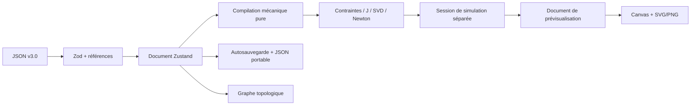

# Architecture et modèle mécanique v0.3

## Circulation des données

## Modules

| Fichier | Responsabilité |
|---|---|
| `src/core/kinematics/types.ts` | Modèle compilé, pilote, analyse, statuts, options |
| `geometry.ts` | Rotations et transformations 2D |
| `model.ts` | Validation mécanique, coordonnées, contraintes et jacobienne |
| `linearAlgebra.ts` | SVD de Jacobi unilatérale, rang et pseudo-inverse |
| `solver.ts` | Newton amorti, régularisation et diagnostics |
| `simulation.ts` | Initialisation, continuation, points suivis, projection vers le rendu |
| `sliderCrank.ts` | Fabrique paramétrée et solution analytique de référence |
| `src/store/useKineoStore.ts` | Document éditable, bâti, CRUD et historique |
| `src/store/useSimulationStore.ts` | Session, commandes, résultats et trajectoire transitoire |
| `src/services/persistence.ts` | Validation et stockage principal/secours sans dépendance à React |
| `documentLifecycle.ts` | Restauration, abonnement document, temporisation et événements de sortie |
| `src/components/kinematics/` | Panneau et horloge requestAnimationFrame |

Le moteur n’importe ni React, ni Zustand, ni un composant, ni une API DOM. Il dépend uniquement du contrat JSON et de ses validateurs. La fabrique bielle-manivelle est un outil de référence ; aucune reconnaissance spéciale de ce mécanisme n’est utilisée par le solveur général.

## Contrat mécanique

- Les coordonnées x/y utilisent toutes `meta.lengthUnit` ; pas de conversion implicite entre unités.
- Les rotations des **solides** et les calculs utilisent des radians, indépendamment de `meta.angleUnit`, qui décrit le contrat historique des DOF. L’interface convertit les angles de saisie/affichage en degrés.
- Les positions optionnelles absentes valent zéro, comme dans le rendu existant.
- Les solides fixes gardent leur pose complète ; plusieurs références fixes sont acceptées et peuvent rendre les contraintes incompatibles.
- Les coordonnées mobiles sont ordonnées selon `classesEquivalence`, par triplets [x, y, θ].
- Les ancrages sont locaux. La position du symbole n’est pas une équation de fermeture.
- L’axe de translation `dof.axisLocal` est attaché au repère A. L’inspecteur expose son angle et synchronise l’orientation graphique.
- Glissière, pivot glissant et encastrement peuvent porter une extension optionnelle `referenceAngle`, angle B − A en radians. À défaut, l’orientation relative de la pose initiale à la compilation est utilisée. Ce choix évite d’inventer un angle nul dans les documents historiques.
- La hiérarchie `parentId` n’a pas de sémantique de transformation composée dans l’ancien rendu : elle reste conservée dans les fichiers mais est refusée par le solveur.

## Cycle de simulation

Analyse : compiler une copie, assembler, afficher les résidus et la mobilité sans pilote. Play : vérifier mobilité 1, ajouter une équation motrice indépendante, assembler la pose initiale puis poursuivre depuis la dernière solution. L’horloge plafonne le pas à 50 ms et ne rattrape pas le temps d’un onglet caché.

L’entrée est une vitesse constante relative B − A pour le pivot, ou une vitesse de déplacement d’ancrage le long de l’axe A pour la glissière. La vitesse peut être négative ou nulle. Le temps est compris entre 0 et 3600 s.

Les états animés sont des clones transitoires : pas d’édition du document, pas d’entrée d’historique, pas d’écriture locale par frame. Les propriétés et le déplacement des solides sont verrouillés pendant cet aperçu ; sélection, vue et zoom restent disponibles. Revenir à l’édition restaure la source. Une modification de la source invalide la session.

La trajectoire conserve au plus 2000 points calculés d’un point local choisi. Changer le point ou reculer le temps recommence le tracé. Les sauts temporels n’interpolent pas une trajectoire fictive.

## Persistance

À l’ouverture, valider l’emplacement principal ; sinon tenter le secours et signaler la récupération. Toute erreur bloque les écritures automatiques. Seul un choix explicite Nouveau/Ouvrir/Exemple réactive le stockage, après archivage du contenu corrompu sous une clé `.recovery.<timestamp>`.

À chaque sauvegarde : valider le nouveau JSON et les références avant de toucher le stockage, valider la précédente sauvegarde, la copier vers le secours, puis écrire la nouvelle principale. En cas de quota/accès refusé, conserver l’erreur visible et les données disponibles. Cette rotation n’est pas une transaction inter-onglets ni une sauvegarde distante.

L’indicateur d’export JSON et l’autosauvegarde restent distincts. Une restauration établit une nouvelle base locale propre. Les sauvegardes se font après 400 ms, lors du passage en arrière-plan et à la sortie. La fermeture demande confirmation si le document diffère de sa base JSON.
